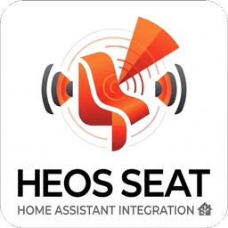

<p align="center"></p>

# HEOS Seat

Intégration Home Assistant qui recentre le son d'une barre de son **Denon HEOS** sur la place occupée,
à partir des positions d'un radar **Aqara FP400**.

Elle baisse l'enceinte arrière la plus proche et monte l'autre (`Surround G` / `Surround D`, comme l'écran
« Niveaux » de l'app HEOS), puis remet les niveaux d'origine quand plus personne n'est là ou que le centrage est coupé.

## Prérequis

- Home Assistant 2025.6 ou plus récent.
- Une barre HEOS joignable en UPnP (port 60006), avec des enceintes arrière.
- L'intégration [`ha-aqara-fp400`](https://github.com/RAR/ha-aqara-fp400) avec le suivi en direct activé :
  l'entité `sensor.…_tracked_people` doit porter un attribut `targets` (`[{id, x, y}]`, en cm).

## Installation

**HACS** : ajouter ce dépôt comme dépôt personnalisé (catégorie « Integration »), installer « HEOS Seat », redémarrer.

**Manuelle** : copier `custom_components/heos_seat` dans `/config/custom_components/`, redémarrer.

Le logo de l'intégration (`custom_components/heos_seat/brand/`) s'affiche à partir de Home Assistant 2026.3.

Puis *Paramètres → Appareils et services → Ajouter une intégration → HEOS Seat* : IP de la barre et entité radar.

## Fonctionnement

- **Positions** : le calibrage est une liste de positions nommées, relevées au radar, chacune avec un réglage
  (G, D) en dB. `left`, `center` et `right` ont des réglages par défaut (−5/+7, 0/0, +7/−5) ; une autre position
  vaut 0/0 jusqu'à ce qu'on la règle. Le capteur peut être n'importe où : s'il bouge, on refait les relevés.
- **Interpolation** : entre les positions, pondération par l'inverse du carré de la distance.
- **Filtrage** : une personne à plus de 70 cm de toute position est ignorée ; la personne suivie le reste
  tant qu'elle est dans la zone, même si quelqu'un d'autre arrive.
- **Stabilité** : médiane sur 2 s, un nouveau réglage doit tenir 2 s ; retour aux niveaux d'origine après 10 s d'absence.
- **Sûreté** : les niveaux d'origine sont gardés sur disque et remis à l'arrêt, au déchargement,
  ou au démarrage suivant si Home Assistant s'est arrêté brutalement.

## Entités et services

| | |
|---|---|
| `switch` Centrage du son | active ou coupe le suivi |
| `sensor` Décalage Surround G / D | décalage appliqué, en dB |
| `heos_seat.save_spot` | relève la position de la **seule** personne vue (`name`, `left_db` et `right_db` facultatifs) |
| `heos_seat.set_spot_levels` | change le réglage d'une position (`name`, `left_db`, `right_db`) |
| `heos_seat.remove_spot` / `clear_calibration` | oublie une position / toutes |
| `heos_seat.set_enabled` | active ou coupe le suivi (`enabled`) |
| `heos_seat.status` | positions, cibles du radar, décalages appliqués |

Les services qui modifient le calibrage renvoient l'état ; en REST : `POST /api/services/heos_seat/<service>?return_response`.
L'onglet « Place » de l'app Android HEOS Fader s'en sert pour le calibrage.

## Développement

```sh
python3.13 -m venv .venv && .venv/bin/pip install -r requirements_test.txt
.venv/bin/pytest
```

`seat.py` (logique de place) et `act.py` (UPnP de la barre) ne dépendent pas de Home Assistant.
